  <picture>
    <source media="(prefers-color-scheme: dark)" srcset="https://raw.githubusercontent.com/StiensWout/StiensWout/output/title-dark.svg?v=3">
    
  </picture>

  <picture>
    <source media="(prefers-color-scheme: dark)" srcset="https://raw.githubusercontent.com/StiensWout/StiensWout/output/snake-dark.svg?v=3">
    
  </picture>

  <a href="https://t3.codes">
    <picture>
      <source media="(prefers-color-scheme: dark)" srcset="https://raw.githubusercontent.com/StiensWout/StiensWout/output/t3code-title-dark.svg?v=3">
      
    </picture>
  </a>

  <a href="https://t3.codes">
    <picture>
      <source media="(prefers-color-scheme: dark)" srcset="https://raw.githubusercontent.com/StiensWout/StiensWout/output/t3code-hub-dark.svg?v=3">
      
    </picture>
  </a>

  <a href="https://t3.codes/download">
    <picture>
      <source media="(prefers-color-scheme: dark)" srcset="https://raw.githubusercontent.com/StiensWout/StiensWout/output/button-t3code-download-dark.svg?v=4">
      
    </picture>
  </a>
  <a href="https://apps.apple.com/us/app/t3-code-remote-claude-more/id6787819824">
    <picture>
      <source media="(prefers-color-scheme: dark)" srcset="https://raw.githubusercontent.com/StiensWout/StiensWout/output/button-t3code-ios-dark.svg?v=4">
      
    </picture>
  </a>
  <a href="https://play.google.com/store/apps/details?id=com.t3tools.t3code">
    <picture>
      <source media="(prefers-color-scheme: dark)" srcset="https://raw.githubusercontent.com/StiensWout/StiensWout/output/button-t3code-android-dark.svg?v=4">
      
    </picture>
  </a>
  <a href="https://app.t3.codes">
    <picture>
      <source media="(prefers-color-scheme: dark)" srcset="https://raw.githubusercontent.com/StiensWout/StiensWout/output/button-t3code-web-dark.svg?v=4">
      
    </picture>
  </a>
  <a href="https://github.com/pingdotgg/t3code">
    <picture>
      <source media="(prefers-color-scheme: dark)" srcset="https://raw.githubusercontent.com/StiensWout/StiensWout/output/button-t3code-github-dark.svg?v=4">
      
    </picture>
  </a>

  <a href="https://github.com/pingdotgg/t3code">
    <picture>
      <source media="(prefers-color-scheme: dark)" srcset="https://raw.githubusercontent.com/StiensWout/StiensWout/output/t3code-dark.svg?v=3">
      
    </picture>
  </a>

  <a href="https://github.com/pingdotgg/t3code/pulls?q=is%3Apr+author%3AStiensWout+is%3Amerged">
    <picture>
      <source media="(prefers-color-scheme: dark)" srcset="https://raw.githubusercontent.com/StiensWout/StiensWout/output/t3code-mine-dark.svg?v=3">
      
    </picture>
  </a>

  <a href="https://mrstreamer.app">
    <picture>
      <source media="(prefers-color-scheme: dark)" srcset="https://raw.githubusercontent.com/StiensWout/StiensWout/output/mrstreamer-title-dark.svg?v=3">
      
    </picture>
  </a>

  <a href="https://mrstreamer.app">
    <picture>
      <source media="(prefers-color-scheme: dark)" srcset="https://raw.githubusercontent.com/StiensWout/StiensWout/output/mrstreamer-guide-dark.svg?v=3">
      
    </picture>
  </a>

  <a href="https://mrstreamer.app">
    <picture>
      <source media="(prefers-color-scheme: dark)" srcset="https://raw.githubusercontent.com/StiensWout/StiensWout/output/button-mrstreamer-mrstreamer-app-dark.svg?v=4">
      
    </picture>
  </a>
  <a href="https://github.com/Mr-Streamer-OSS/MrStreamer/releases/latest">
    <picture>
      <source media="(prefers-color-scheme: dark)" srcset="https://raw.githubusercontent.com/StiensWout/StiensWout/output/button-mrstreamer-download-dark.svg?v=4">
      
    </picture>
  </a>
  <a href="https://github.com/Mr-Streamer-OSS/MrStreamer">
    <picture>
      <source media="(prefers-color-scheme: dark)" srcset="https://raw.githubusercontent.com/StiensWout/StiensWout/output/button-mrstreamer-github-dark.svg?v=4">
      
    </picture>
  </a>

  <a href="https://github.com/Mr-Streamer-OSS/MrStreamer/releases">
    <picture>
      <source media="(prefers-color-scheme: dark)" srcset="https://raw.githubusercontent.com/StiensWout/StiensWout/output/mrstreamer-dark.svg?v=3">
      
    </picture>
  </a>

