# Hi, I'm Wout

I build things in Brussels: mostly on [T3 Code](https://github.com/pingdotgg/t3code), and [Mr. Streamer](https://mrstreamer.app) on the side.

<picture>
  <source media="(prefers-color-scheme: dark)" srcset="https://raw.githubusercontent.com/StiensWout/StiensWout/output/snake-dark.svg">
  
</picture>

## T3 Code

[pingdotgg/t3code](https://github.com/pingdotgg/t3code), the best way to control Claude Code, Codex and more from any computer or phone. [207 merged PRs](https://github.com/pingdotgg/t3code/pulls?q=is%3Apr+author%3AStiensWout+is%3Amerged) so far, among them:

- The [Pi coding agent](https://github.com/pingdotgg/t3code/pull/7211) as a provider, and [standardized ACP providers](https://github.com/pingdotgg/t3code/pull/6461)
- Terminals [rendered with libghostty-vt](https://github.com/pingdotgg/t3code/pull/4860), with faster history, scrollback and links
- A [theme library](https://github.com/pingdotgg/t3code/pull/5226), [OKLCH palettes](https://github.com/pingdotgg/t3code/pull/6036) and [configurable fonts](https://github.com/pingdotgg/t3code/pull/5103)
- A [cold-start bundle cut in half](https://github.com/pingdotgg/t3code/pull/9058) and a long run of server and desktop speedups
- Mobile fixes, like [starting a thread on an existing branch](https://github.com/pingdotgg/t3code/pull/10359)

## Mr. Streamer

[mrstreamer.app](https://mrstreamer.app) · [Mr-Streamer-OSS/MrStreamer](https://github.com/Mr-Streamer-OSS/MrStreamer)

A free, open source IPTV player for Mac, Windows and Linux. Bring your own Xtream Codes or M3U subscription and watch live TV with a programme guide, movies and series.
